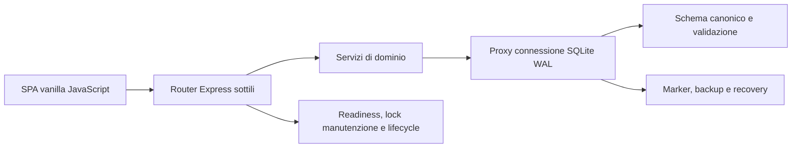

# Architettura operativa di EventOrder

Questo documento descrive lo stato corrente. Le analisi storiche restano nei documenti
di audit e non vanno usate come fotografia del codice attuale.

## Confini principali

- `src/routes/` traduce HTTP in chiamate di dominio; non deve accumulare regole di
  vendita, cassa, catalogo o reporting.
- `src/sales/`, `src/products/`, `src/carts/`, `src/sessions/` e `src/reporting/`
  possiedono calcoli, transazioni e contratti applicativi.
- `src/db.js` orchestra apertura, migrazione e swap della connessione. La recovery dei
  file e dei marker vive in `src/database-recovery.js`; la validazione canonica in
  `src/database-validation.js`.
- `src/maintenance.js` serializza backup e restore. Un restore mantiene il lock fino
  alla conclusione del lavoro anche se il client HTTP si disconnette.
- `src/operational-status.js` separa liveness e readiness; `src/server-lifecycle.js`
  rende lo shutdown limitato nel tempo e testabile.
- Il frontend non usa moduli ES né build step. Le shell caricano, in ordine, i modelli
  globali puri (`cart-model.js`, `operation-attempts.js`, `payment-model.js`), i
  controller di pagina e infine `app.js`, che governa shell, navigazione e modali.

## Flusso checkout

`payment-model.js` possiede stato e calcoli di metodo, sconto, contanti, resto e payload.
`cassa-controller.js` riconcilia il catalogo, rende il DOM e invia l'esatto tentativo
persistito. Il backend valida nuovamente tutto in `sales/checkout.js`, calcola in
centesimi, scrive vendita, righe e indice FTS nella stessa transazione e poi esegue lo
stub di stampa. Un esito di rete incerto riusa chiave e payload originali.

## Flusso restore

1. La route acquisisce il lock esclusivo prima di leggere il file.
2. L'upload viene scritto con limite e permessi restrittivi in un candidato temporaneo.
3. Vengono verificati spazio, formato SQLite, versione e dati.
4. Si crea e verifica un backup pre-restore del database attivo.
5. Il candidato viene canonicalizzato nello schema corrente; indice FTS e dati derivati
   vengono ricostruiti.
6. Marker, rename, fsync e checkpoint rendono recuperabile ogni finestra di crash.
7. La connessione proxy viene sostituita, l'identità del database ruota e le sessioni di
   autenticazione vengono invalidate.
8. Il lock viene rilasciato soltanto al termine dell'operazione.

`npm run test:restore-drill` attraversa backup, verifica, restore, riapertura applicativa
e controllo degli invarianti su un database temporaneo.

## Invarianti non negoziabili

- denaro persistito come centesimi interi entro i limiti validati;
- snapshot delle righe vendute immutabili dopo la vendita;
- retry con la stessa chiave idempotente e lo stesso payload;
- un solo processo per database SQLite, WAL con `synchronous=FULL`;
- restore e migrazioni fail-closed verso lo schema canonico corrente;
- nessuno statement conservato oltre lo swap della connessione;
- nessun accesso LAN senza PIN, host e origin espliciti;
- TLS terminato al confine di deployment;
- stampa hardware fuori perimetro finché non vengono scelti prodotto e protocollo.

## Controlli di non regressione

I ratchet dimensionali sono in `test/architecture.test.js`. Vanno abbassati dopo una
vera estrazione e non alzati per far entrare nuovo codice. `cassa-controller.js` è
limitato a 1.200 righe; `payment-model.js` a 160 e `src/db.js` a 800.

JSDoc/checkJs è stato valutato per i nuovi confini puri, ma non introdotto: gli oggetti
globali e il caricamento senza build step richiederebbero una nuova toolchain e numerose
dichiarazioni ambientali. I contratti critici sono invece verificati da test di boundary,
test HTTP e Playwright; la scelta va rivalutata solo se compare un secondo consumatore
staticamente tipizzato.
